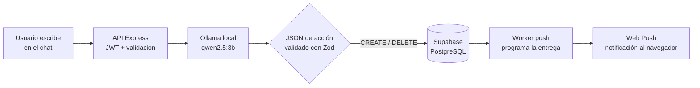

<div align="center">

# YourAssistant

**Asistente virtual personal con IA local, recordatorios y notificaciones push**

[](LICENSE)
[](#estado-del-proyecto)
[](https://nodejs.org)
[](https://react.dev)
[](https://vite.dev)
[](https://expressjs.com)
[](https://supabase.com)
[](https://ollama.com)
[](#)

</div>

## ¿Qué es YourAssistant?

YourAssistant es una **aplicación web progresiva (PWA)** que funciona como un asistente personal con inteligencia artificial. El usuario conversa en lenguaje natural —por ejemplo, *"recuérdame llamar al dentista mañana a las 3 pm"*— y un modelo de lenguaje **local (Ollama + Qwen)** interpreta la petición, genera una acción estructurada y la traduce en un **recordatorio** que se le notifica al usuario en el momento oportuno mediante **Web Push**, incluso con la app instalada en el celular.

Todo el procesamiento del LLM ocurre en la máquina del usuario: **sin APIs de IA de pago, sin enviar tus datos a terceros**.

## Cómo funciona



1. El usuario envía un mensaje desde la PWA.
2. El backend (Express) lo envía a **Ollama**, que responde con JSON de acción (`CREATE`, `DELETE`…) y campos validados con **Zod** — si el modelo alucina un formato inválido, la acción se descarta y no toca la base de datos.
3. El recordatorio se persiste en **Supabase** (PostgreSQL) con el *lead time* de notificación elegido.
4. Un **worker** independiente encola las entregas vencidas y envía la notificación **Web Push** al dispositivo, con reintentos automáticos ante fallos transitorios.

## Características

- **Chat con IA local**: interpretación de peticiones en lenguaje natural para crear o eliminar recordatorios.
- **Recordatorios inteligentes**: listado, estados pendiente/completado y aviso configurable (minutos u horas antes).
- **Notificaciones Web Push**: suscripción desde la PWA instalable, con reintentos y recuperación de entregas perdidas.
- **Vista de calendario** integrada en el panel de trabajo.
- **PWA instalable**: funciona como app en escritorio y móvil, con shell offline.
- **Autenticación y perfiles**: registro, login y gestión de perfil con Supabase Auth (JWT).
- **Panel de administración**: los administradores pueden cambiar el modelo activo de Ollama sin reiniciar el servicio.
- **Seguridad por diseño**: validación de entrada/salida con Zod, autorización por usuario en cada consulta y claves sensibles solo en el servidor.

## Stack tecnológico

| Capa | Tecnologías |
|---|---|
| Frontend | React 19, Vite 7, Tailwind CSS 4, React Router 7, `vite-plugin-pwa`, Lucide icons |
| Backend | Node.js 24, Express 5, Zod 4, `web-push`, PM2 |
| Datos | Supabase (PostgreSQL, RPCs y funciones programadas) |
| IA | Ollama con `qwen2.5:3b` (modelo por defecto, intercambiable) |
| Despliegue | Frontend en Vercel; backend, worker y Ollama en máquina local (túnel ngrok opcional) |
| Testing | `node --test` (backend), Vitest + Testing Library (frontend) |

## Estructura del proyecto

```
YourAssistant/
├── backend/                  # API Express (arquitectura MVC)
│   ├── src/
│   │   ├── controllers/      # Manejo HTTP + validación
│   │   ├── services/         # Lógica de negocio (asistente, push, Ollama)
│   │   ├── models/           # Acceso a datos + esquemas Zod
│   │   ├── routes/           # Endpoints
│   │   ├── middlewares/      # Auth JWT y roles
│   │   └── workers/          # Worker de notificaciones push
│   └── .env.example
├── frontend/                 # PWA (React + Vite)
│   ├── src/
│   │   ├── components/       # Paneles de chat, calendario, recordatorios
│   │   ├── pages/            # Login, espacio de trabajo, perfil, admin
│   │   ├── services/         # Cliente HTTP y APIs
│   │   └── sw.js             # Service Worker (offline + push)
│   └── vercel.json
├── supabase/
│   └── migrations/           # Esquema: settings, recordatorios, push
└── README.md
```

## API

| Método | Ruta | Descripción |
|---|---|---|
| `POST` | `/api/auth/register` | Registro de usuario |
| `POST` | `/api/auth/login` | Login y obtención de JWT |
| `GET`/`PUT` | `/api/auth/profile` | Ver / actualizar perfil |
| `PATCH` | `/api/auth/profile/email` | Cambiar email |
| `POST` | `/api/assistant/prompt` | Enviar petición al asistente (IA) |
| `GET` | `/api/reminders` | Listar recordatorios por rango de fechas |
| `PATCH` | `/api/reminders/:id/status` | Marcar completado/pendiente |
| `PATCH` | `/api/reminders/:id/notification-offset` | Cambiar aviso previo |
| `GET` | `/api/push/config` | Clave pública VAPID |
| `PUT`/`DELETE` | `/api/push/subscription` | Registrar/eliminar suscripción push |
| `GET`/`PUT` | `/api/admin/models` | Listar/cambiar modelo activo *(solo admin)* |

## Puesta en marcha

**Requisitos**: Node.js 24+, [Ollama](https://ollama.com) con `ollama pull qwen2.5:3b`, y un proyecto en [Supabase](https://supabase.com).

```bash
# 1. Base de datos: aplicar supabase/migrations/ en orden (SQL Editor)

# 2. Backend
cd backend
cp .env.example .env    # completar SUPABASE_*, OLLAMA_URL y VAPID_*
npm install
npm run dev             # API en http://localhost:3000

# 3. Worker de notificaciones (otra terminal)
npm run worker

# 4. Frontend
cd ../frontend
cp .env.example .env    # opcional en local
npm install
npm run dev             # http://localhost:5173 (proxea /api al backend)
```

Genera tus claves VAPID con:

```bash
node --input-type=module -e "import webPush from 'web-push'; console.log(webPush.generateVAPIDKeys())"
```

## Testing

```bash
cd backend  && npm test   # 35 tests (unitarios: servicios, modelos, controladores, middleware)
cd frontend && npm test   # 18 tests (componentes, servicios, utilidades)
```

## Despliegue

El frontend puede desplegarse en **Vercel**: `frontend/vercel.json` proxea `/api/*` hacia el backend publicado (por ejemplo, con un túnel [ngrok](https://ngrok.com) sobre el puerto 3000). El backend, el worker y Ollama permanecen en la máquina local; la base de datos siempre está en Supabase.

## Estado del proyecto

⚠️ **Proyecto en desarrollo activo.** El núcleo (chat con IA, recordatorios y Web Push) funciona end-to-end, pero faltan pulir: correcciones de fiabilidad en algunos navegadores, edición de recordatorios desde el chat, pruebas E2E, CI/CD y mejoras de UI. El roadmap incluye Dockerización y soporte multi-idioma.

## Seguridad

- La clave **service_role** de Supabase y las claves **VAPID** viven únicamente en el `.env` del backend — nunca en el repositorio ni en el navegador.
- La salida del LLM se valida con **Zod** antes de tocar la base de datos.
- Todas las rutas de datos verifican el JWT y filtran por usuario: nadie puede ver los recordatorios de otro usuario.

## Licencia

Distribuido bajo la licencia [MIT](LICENSE).
